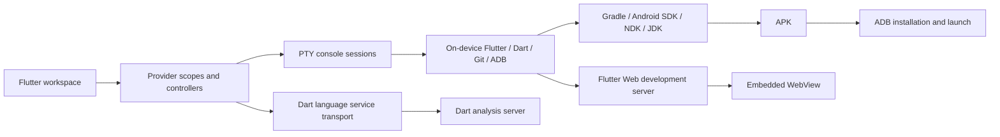
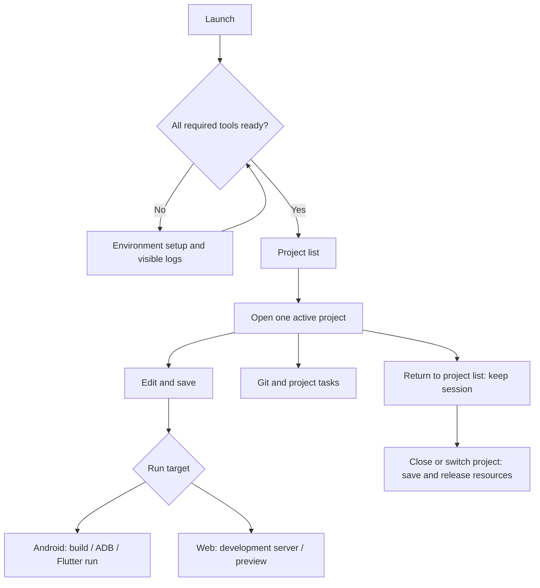

<p align="center">
  
</p>

<h1 align="center">Flit</h1>

<p align="center">A Flutter development workspace for Android.</p>

<p align="center">
  <a href="https://github.com/lycstar/flit/releases"></a>
  <a href="https://github.com/lycstar/flit/actions/workflows/android-release.yml"></a>
  <a href="https://github.com/lycstar/flit/stargazers"></a>
  <a href="LICENSE"></a>
  
</p>

<p align="center">
  <a href="https://github.com/lycstar/flit/releases">Download preview</a> ·
  <a href="docs/architecture.md">Architecture</a> ·
  <a href="https://github.com/lycstar/flit/issues">Report an issue</a> ·
  <a href="CONTRIBUTING.md">Contributing</a>
</p>

English · [简体中文](README.zh-CN.md)

Edit Dart code, build applications on the device, run them over wireless ADB, or preview Flutter Web in the editor.

Application ID: `cc.lycstar.flit` · Android 7.0+ · arm64-v8a

## Features

- Create, clone and open projects stored in the application’s project directory.
- Edit multiple files with syntax highlighting, completion, diagnostics and signature help from the official Dart analysis server.
- Run shell commands and inspect streaming build, setup and Git output in the integrated terminal.
- Build APKs, connect Android devices over wireless ADB, and use Flutter hot reload and hot restart.
- Preview Flutter Web inside the workspace; use code/preview switching on phones and a split view on wide screens.
- Stage, commit, manage branches, pull and push with Git; sign in to GitHub through its device authorization flow.
- Share files and access projects from the system Files app through Android’s Storage Access Framework.

## Start using Flit

1. Download an APK from [Releases](https://github.com/lycstar/flit/releases) and install it on an arm64 Android device.
2. Complete **Development environment** setup. All required components must be ready before creating or building projects. Installation output remains visible in the terminal.
3. Create or clone a project, or open a directory from the project list.
4. Select Web preview or connect an Android device. Run, inspect the output, and use reload/restart while editing.

Wireless pairing on the same device requires Android 11+ and wireless debugging enabled in Developer options. Manual host/port connection is available for an already configured ADB endpoint. Pairing history is not proof of a current connection: Flit checks the device state reported by ADB.

Projects live in the app’s private `files/home/projects` directory. **Uninstalling Flit or clearing its data deletes those projects.** Back them up with Git or copy them through **Files → Flit 工程**. GitHub authentication is optional; local development does not require an account.

## How it works



The APK contains the editor, native bridges and setup scripts. Setup downloads the development environment separately: bootstrap userland, OpenJDK, Android SDK/NDK and a Flutter SDK built for **Android bionic aarch64**. Desktop Linux tools cannot replace these executables.



## Build from source

Use Flutter **3.47.7**, JDK **17**, Android SDK and NDK **28.2.13676358**. Gradle Wrapper is included. `flutter pub get` resolves the local native plugins as well as hosted dependencies.

```sh
flutter pub get
flutter analyze
flutter test
python3 -m unittest discover -s test -p '*test.py'
flutter build apk --debug --target-platform android-arm64
```

The release workflow runs manually. Configure `KEYSTORE_BASE64`, `ANDROID_STORE_PASSWORD`, `ANDROID_KEY_ALIAS` and `ANDROID_KEY_PASSWORD` as repository Secrets for signed releases. Local signing uses an ignored `android/key.properties` file; without release signing configuration, local builds use a debug key.

## Runtime distributions

The application’s default downloads and SHA-256 digests are defined in [`assets/toolchain_manifest.json`](assets/toolchain_manifest.json). Bootstrap and APT packages must be compiled for `/data/data/cc.lycstar.flit/files/usr`. Changing a URL or application ID does not relocate another application’s binaries.

| Companion repository | Responsibility |
| --- | --- |
| [flit-termux-packages](https://github.com/lycstar/flit-termux-packages) | Flit bootstrap and APT packages |
| [llvm-custom](https://github.com/lycstar/llvm-custom) | Android bionic LLVM host tools |
| [android-sdk-custom](https://github.com/lycstar/android-sdk-custom) | Android SDK host tools |
| [android-ndk-custom](https://github.com/lycstar/android-ndk-custom) | Android NDK for Android hosts |
| [flutter-sdk-custom](https://github.com/lycstar/flutter-sdk-custom) | Flutter and Dart SDK distribution |

Toolchain build recipes belong in those repositories. This repository contains only the application’s installation scripts and distribution manifest. See [runtime configuration](docs/runtime-environment.md) for version catalogs and validation requirements.

## Structure

| Directory | Responsibility |
| --- | --- |
| `lib/main.dart`, `lib/app.dart` | Compose application services and configure the app |
| `lib/core/` | Provider scope, theme and shared layout |
| `lib/features/` | Projects, workspace, editor, terminal, environment, device, Git and settings |
| `lib/services/` | Stateless process/file boundaries and system integration |
| `plugins/` | Five focused Android native plugins |
| `assets/` | Installation scripts, download manifest, icons and fonts |
| `test/` | Controller, widget, protocol and installation-script tests |
| `docs/` | Architecture, runtime configuration and interaction rules |
| `third_party/` | Vendored sources and their licenses |

Read [architecture](docs/architecture.md), [session ownership](docs/session-model.md), [device connection](docs/device-connection.md) and [contribution guidelines](CONTRIBUTING.md) before changing shared flows.

## Limitations

- Android target SDK is fixed at 28 because development tools execute from app-private storage; distribution is intended for sideloading.
- Complete toolchain setup and network access for initial artifacts/dependencies are required. Project caches and build outputs consume additional storage.
- One project is active at a time. Returning to the project list keeps its tasks alive; closing or switching the project saves documents and stops its processes.
- An Android process kill does not restore terminal processes or unsaved in-memory sessions. A foreground service helps keep active work alive but cannot guarantee survival.
- Automated tests and APK compilation do not establish device compatibility for every toolchain version; validate setup, build, installation and reload on a real arm64 device before releasing.

## Credits and license

Flit is licensed under [GNU GPL v3.0](LICENSE). Third-party code, fonts and downloaded tools retain their respective licenses; see [THIRD_PARTY_NOTICES.md](THIRD_PARTY_NOTICES.md).

Built with [Flutter](https://github.com/flutter/flutter), [Termux packages](https://github.com/termux/termux-packages) and xterm.dart. Toolchain work draws on [mumumusuc/termux-flutter](https://github.com/mumumusuc/termux-flutter), [HomuHomu833](https://github.com/HomuHomu833), [lzhiyong/android-sdk-tools](https://github.com/lzhiyong/android-sdk-tools) and [Android Code Studio](https://github.com/AndroidCSOfficial/android-code-studio).
