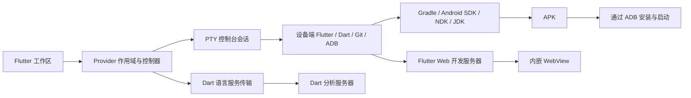
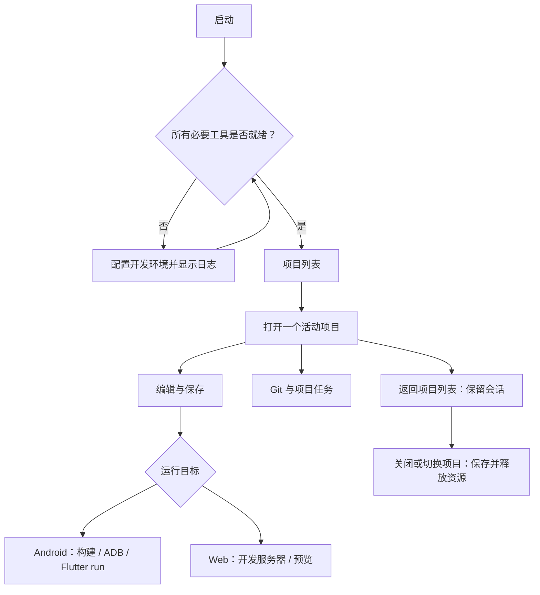

<p align="center">
  
</p>

<h1 align="center">Flit</h1>

<p align="center">在 Android 上编辑、构建和运行 Flutter 项目的开发工作区。</p>

<p align="center">
  <a href="https://github.com/lycstar/flit/releases"></a>
  <a href="https://github.com/lycstar/flit/actions/workflows/android-release.yml"></a>
  <a href="https://github.com/lycstar/flit/stargazers"></a>
  <a href="LICENSE"></a>
  
</p>

<p align="center">
  <a href="https://github.com/lycstar/flit/releases">下载预览版</a> ·
  <a href="docs/architecture.md">架构说明</a> ·
  <a href="https://github.com/lycstar/flit/issues">反馈问题</a> ·
  <a href="CONTRIBUTING.md">参与贡献</a>
</p>

[English](README.md) · 简体中文

Flit 支持编辑 Dart 代码、在设备上构建应用、通过无线 ADB 运行应用，以及在编辑器内预览 Flutter Web。

应用 ID：`cc.lycstar.flit` · Android 7.0+ · arm64-v8a

## 功能

- 创建、克隆和打开应用工程目录中的项目。
- 多文件编辑，支持语法高亮，以及官方 Dart 分析服务器提供的代码补全、诊断和签名提示。
- 在集成终端中执行 shell 命令，实时查看构建、环境安装和 Git 输出。
- 构建 APK，通过无线 ADB 连接 Android 设备，使用 Flutter 热重载与热重启。
- 在工作区内预览 Flutter Web；手机切换代码与预览，宽屏并排显示。
- 使用 Git 暂存、提交、管理分支、拉取和推送；通过设备授权流程登录 GitHub。
- 分享文件，并通过 Android 存储访问框架（SAF）在系统“文件”应用中访问工程。

## 开始使用

1. 从 [Releases](https://github.com/lycstar/flit/releases) 下载 APK，安装到 arm64 Android 设备。
2. 完成**开发环境**配置。创建或构建项目之前，所有必要组件必须就绪。安装输出会持续显示在终端中。
3. 创建或克隆项目，也可以从项目列表打开目录。
4. 选择 Web 预览或连接 Android 设备，运行项目、查看输出，并在编辑时使用热重载或热重启。

本机无线配对需要 Android 11 及以上，并在开发者选项中启用无线调试。对于已配置的 ADB 端点，可手动输入主机和端口连接。配对记录不代表当前已连接：Flit 以 ADB 返回的设备状态为准。

工程保存在应用私有的 `files/home/projects` 目录中。**卸载 Flit 或清除应用数据会删除这些工程。** 请使用 Git 备份，或通过**文件 → Flit 工程**复制。GitHub 登录是可选功能，本地开发不需要账户。

## 工作原理



APK 包含编辑器、原生桥接和安装脚本。开发环境在初始化时单独下载，包括 bootstrap 基础用户环境、OpenJDK、Android SDK/NDK，以及为 **Android bionic aarch64** 构建的 Flutter SDK。桌面 Linux 工具不能替代这些可执行文件。



## 从源码构建

使用 Flutter **3.47.8**、JDK **17**、Android SDK 和 NDK **28.2.13676358**。仓库包含 Gradle Wrapper。`flutter pub get` 会解析本地原生插件及托管依赖。

```sh
flutter pub get
flutter analyze
flutter test
python3 -m unittest discover -s test -p '*test.py'
flutter build apk --debug --target-platform android-arm64
```

发布工作流通过手动触发运行。签名发布需要在仓库 Secrets 中配置 `KEYSTORE_BASE64`、`ANDROID_STORE_PASSWORD`、`ANDROID_KEY_ALIAS` 和 `ANDROID_KEY_PASSWORD`。本地签名使用不纳入版本控制的 `android/key.properties`；未配置发布签名时，本地构建使用调试密钥。

## 运行环境分发

应用只保留仓库和默认版本，安装时按 tag 从 GitHub API 获取下载资产与 SHA-256，不内置下载清单。bootstrap 和 APT 软件包必须针对 `/data/data/cc.lycstar.flit/files/usr` 编译。修改下载地址或应用 ID，不能迁移为其他应用编译的二进制文件中的路径。

| 配套仓库 | 职责 |
| --- | --- |
| [flit-termux-packages](https://github.com/lycstar/flit-termux-packages) | Flit bootstrap 与 APT 软件包 |
| [llvm-custom](https://github.com/lycstar/llvm-custom) | Android bionic LLVM 宿主工具 |
| [android-sdk-custom](https://github.com/lycstar/android-sdk-custom) | Android SDK 宿主工具 |
| [android-ndk-custom](https://github.com/lycstar/android-ndk-custom) | 面向 Android 宿主的 Android NDK |
| [cmake-custom](https://github.com/lycstar/cmake-custom) | 面向 Android ARM64 宿主的 CMake 与 Ninja |
| [flutter-sdk-custom](https://github.com/lycstar/flutter-sdk-custom) | Flutter 与 Dart SDK 分发 |

工具链构建脚本由这些仓库维护。本仓库维护应用安装脚本和版本选择规则。版本目录与验证要求见[运行环境配置](docs/runtime-environment.md)。

工具链 Tag 统一使用组件前缀与完整版本：`sdk-36.0.0`（Build Tools）、`ndk-r27d`、`llvm-r27d`、`cmake-3.22.1`、`flutter-3.47.8`。NDK 的 r27 与 r27d 属于不同修订版，独立发布。

SDK 使用 `sdk-<Build Tools版本>` 发布，整包只带对应的一个 Platform；`platform-<API>` 提供独立平台分包。当前提供 Build Tools **34.0.0、35.0.0、36.0.0、37.0.0**，App 默认初始化 36.0.0。NDK 补充构建 **r25b（25.1.8937393）、r26b（26.1.10909125）、r27（27.0.12077973）**，与已有 r28c 及更新版本并存。构建发布成功后，相应版本才会出现在版本目录中。CMake **3.22.1** 与 **3.31.6** 也可在同一目录中选择。

应用的 APK 构建和 Android 设备运行由独立 `AndroidBuildWrapper` 检查缺失组件，确认后安装并最多重试一次；覆盖 Platform、Build Tools、NDK、CMake/Ninja 和设备运行所需的 Platform Tools。宿主工具保持 ARM64 适配包，AGP 通用自动下载保持关闭。

## 目录结构

| 目录 | 职责 |
| --- | --- |
| `lib/main.dart`、`lib/app.dart` | 组合应用服务并配置应用 |
| `lib/core/` | Provider 作用域、主题与共享布局 |
| `lib/features/` | 项目、工作区、编辑器、终端、环境、设备、Git 与设置 |
| `lib/services/` | 无状态的进程与文件边界、系统集成 |
| `plugins/` | 五个职责明确的 Android 原生插件 |
| `assets/` | 安装脚本、图标与字体 |
| `test/` | 控制器、组件、协议与安装脚本测试 |
| `docs/` | 架构、运行环境配置与交互规则 |
| `third_party/` | 随仓库维护的第三方源码及其许可证 |

修改共享流程前，请阅读[架构说明](docs/architecture.md)、[会话所有权](docs/session-model.md)、[设备连接](docs/device-connection.md)及[贡献指南](CONTRIBUTING.md)。

## 使用限制

- Android target SDK 固定为 28，以便从应用私有目录执行开发工具；应用通过侧载分发。
- 设备端构建使用 ARM64 宿主工具，禁止 AGP 自动下载 SDK/NDK/CMake；构建前须安装项目要求的版本。工具链按版本共存，更改前须关闭活动项目。
- 必须完成整个工具链安装，首次下载工具及依赖需要网络。项目缓存和构建产物还会占用额外存储空间。
- 同一时间保留一个活动项目。返回项目列表会保留任务；关闭或切换项目会保存文档并停止所属进程。
- Android 进程被终止后，不会恢复终端进程或尚未落盘的内存会话。前台服务有助于维持活动任务，但无法保证进程持续存活。
- 自动测试与 APK 编译无法证明每个工具链版本的设备兼容性。发布前需在真实 arm64 设备上验证环境安装、构建、应用安装及热重载。

## 致谢与许可证

Flit 使用 [GNU GPL v3.0](LICENSE) 许可证。第三方代码、字体和下载工具保留各自的许可证，详见 [THIRD_PARTY_NOTICES.md](THIRD_PARTY_NOTICES.md)。

项目基于 [Flutter](https://github.com/flutter/flutter)、[Termux packages](https://github.com/termux/termux-packages) 和 xterm.dart。工具链工作参考了 [mumumusuc/termux-flutter](https://github.com/mumumusuc/termux-flutter)、[HomuHomu833](https://github.com/HomuHomu833)、[lzhiyong/android-sdk-tools](https://github.com/lzhiyong/android-sdk-tools) 及 [Android Code Studio](https://github.com/AndroidCSOfficial/android-code-studio)。
