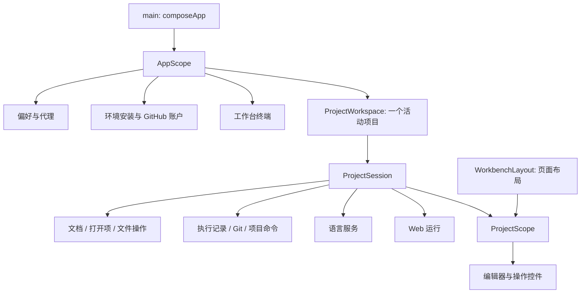

# 应用结构与状态管理

Flit 使用 Provider 分发现有控制器，不额外引入通用仓库层、事件总线或全局 Store。业务按功能组织，所有权按生命周期划分。

## 应用级

`main.dart` 负责创建依赖、加载代理与偏好、设置系统窗口后启动应用。`app.dart` 配置主题、本地化、导航观察者和前后台代理刷新。`projects/workbench_page.dart` 管理启动检测、项目列表及页面跳转。

`AppScope` 提供 `EnvironmentController`、`GithubAccount`、`AppearancePreferences`、`AutoProxy`、工作台 `PtySession`、`ProjectWorkspace`、进程启动器及版本目录。它们由组合根创建，使用 `.value` 提供；页面离开不销毁应用任务。

`Shell` 等无状态原生边界保留简单门面。无需将每一个 MethodChannel 或纯函数包装成 Provider。

## 项目级

`ProjectWorkspace` 串行打开、关闭和切换项目。`ProjectSession` 持有文档、打开项、文件列表、任务、Git、Web 和语言服务；`ProjectScope` 只分发这些对象，不接管关闭流程。`WorkbenchLayout` 属于编辑器页面，控制抽屉、键盘和预览展示。

页面用 `context.read<T>()` 发起操作，用 `watch` 或 `select` 订阅展示状态。保留显式监听仅用于副作用，例如文件树重扫、产物打开和路由历史同步。选区、文本编辑与 LSP 消息仍使用各自的控制器，不把高频事件汇入应用级状态。

环境启动检测与设置页通过同一个 `EnvironmentStatus` 判断：检查命令成功，并且所有必要组件的最后状态都是 `DONE`。环境页的安装过程由 `EnvironmentController` 编排，输出原样保留在任务终端。

## 原生边界

详见 [插件说明](../plugins/README.md)。Android `MainActivity` 仅管理窗口。原生插件不持有 Flutter 页面状态，也不决定运行、保存或 Git 流程。

## 变更原则

- 文件修改先协调文档保存，外部修改与 Git 工作区切换不得被旧缓冲覆盖。
- 运行按钮绑定目标执行，日志查看选择不改变热重载的接收者。
- 自动任务独立于交互 shell，完成以退出码及输出结束为准。
- 关闭项目负责释放资源；Provider 的 widget 卸载不等于关闭项目。
- 环境完整安装是统一前置条件，不按每个功能维护不同的可用状态组合。

详细行为见 [会话模型](session-model.md)。
