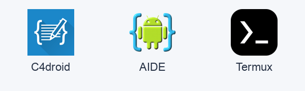
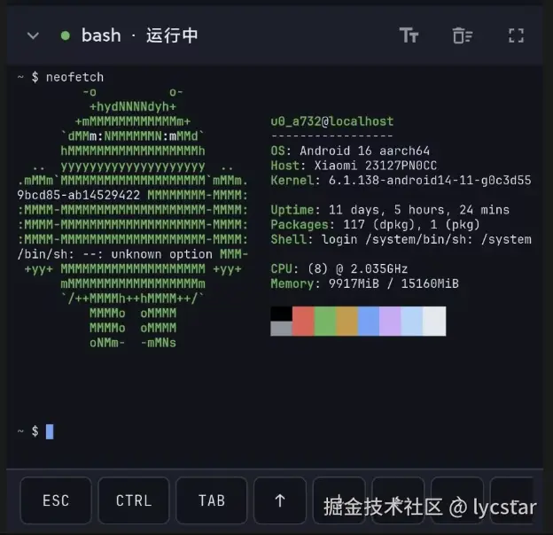
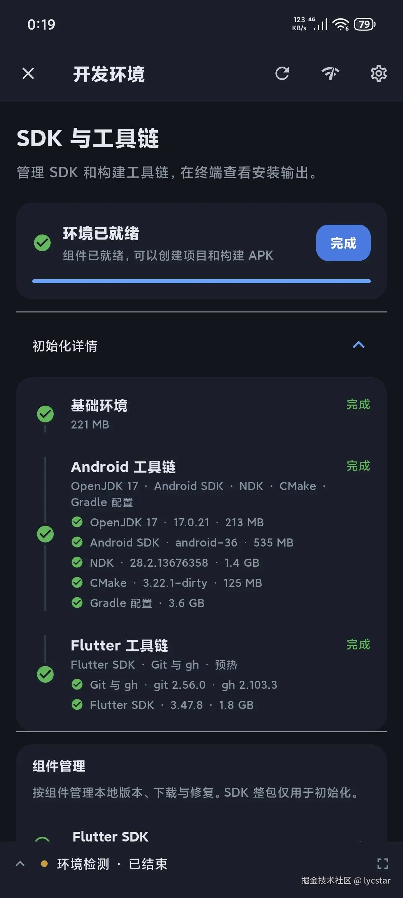
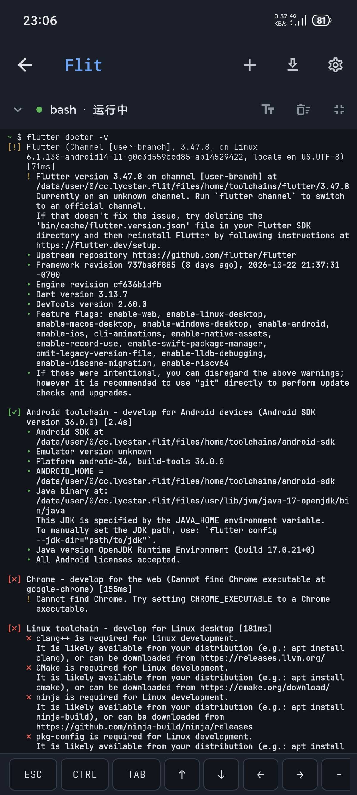
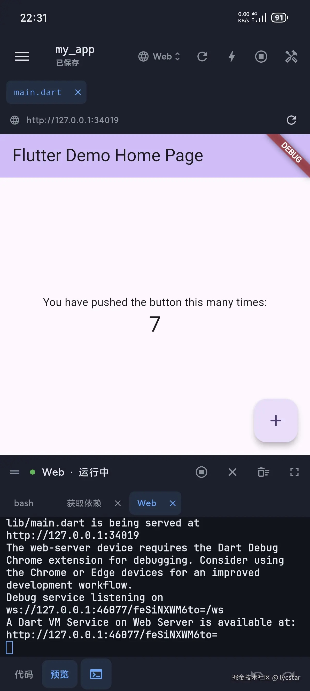
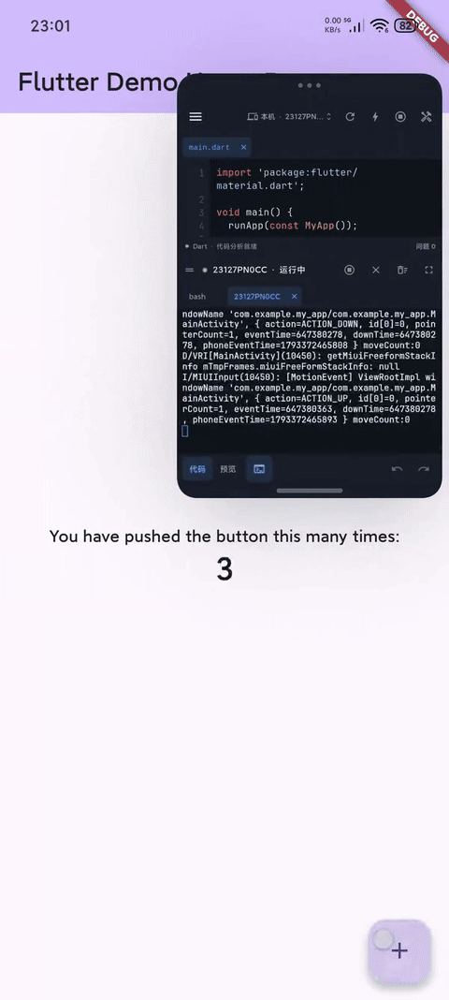

# 如何在 Android 设备上构建 Flutter 应用：Flit 的工具链移植实践

最近，我终于实现了一个惦记多年的想法：在 Android 手机上开发 Flutter 应用。

高中时家里没有电脑，我用过 C4droid 学 C，用 AIDE 写 Android 应用，也常常好奇它们是怎么在手机上编译程序的。大学接触 Flutter 后，我开始尝试把它搬到 Termux。最初只调整了部分 Flutter tools，虽然能运行，但只能构建 Flutter Web 应用。后来分析依赖才发现，要在手机上构建 Android APK，还需要为 Android bionic/ARM64 交叉编译 Flutter SDK 和 Android 构建工具链；我尝试过几次，都没有走通。最近借助 AI，我重新梳理了整条构建链的依赖，终于做出了 [Flit](https://github.com/lycstar/flit)，一个运行在 Android 上的 Flutter 项目开发工具。



## 一、Flutter 是如何编译出 APK 的

先从一条最常见的命令看起：

```sh
flutter build apk --target-platform android-arm64
```

这条命令背后并不是单个编译器，而是一条由多个工具接力的构建链。Flutter CLI 本身是用 Dart 写的工具，由 Flutter SDK 里的 Dart 运行时启动；它先把项目 Dart 代码组织成构建输入，再调用项目 Android 目录里的 Gradle。

Gradle 运行在 OpenJDK 上，通过 Android Gradle Plugin（AGP）协调 Android 构建：Java 和 Kotlin 源码编译为字节码，再转换为 DEX；Android 资源由 AAPT2 编译和链接。项目或插件需要编译 C/C++ 源码时，还会用到 NDK，以及 CMake、Ninja 等构建工具。

Flutter 侧则根据构建模式处理 Dart 产物：debug 构建支持 JIT 调试，release/profile 构建由 `gen_snapshot` 生成 AOT 代码。最后，Android 代码、资源、Flutter 引擎和 Dart 产物一起组装成 APK。

所以，要在 Android 手机上完成这条流程，至少需要这些环境：

| 组件 | 在构建中的作用 | 处理方式 |
| --- | --- | --- |
| 终端 / 用户空间 | 提供 shell、包管理器和进程环境 | 为 Flit 私有前缀重建 Termux bootstrap 和 APT 包 |
| OpenJDK | 运行 Gradle 和 Java 工具 | 沿用 Termux 官方包配方交叉编译，通过 APT 安装 |
| Gradle / AGP | 协调 Android 构建和依赖 | 复用官方 Java/JVM 发行版，由 OpenJDK 运行 |
| Android SDK | 提供 Platform、Build Tools 和打包工具 | 交叉编译宿主工具，复用平台资源 |
| NDK / CMake / Ninja | 编译原生插件 | 交叉编译 LLVM 和 CMake/Ninja，再组装 NDK |
| Flutter SDK | 编译 Dart、提供分析和运行工具 | 交叉编译宿主工具，复用 Android 引擎产物 |
| Git、GitHub CLI 等额外工具 | Flutter 工具和应用内功能需要 | 沿用 Termux 官方包配方交叉编译，通过 APT 安装 |

这里的难点不是把所有文件都“重新编译一遍”，真正必须处理的，是那些要在 Android ARM64/bionic 环境里执行的原生程序。

## 二、Termux bootstrap：先得到 shell 和 APT

[Termux](https://github.com/termux/termux-packages) 是 Android 上的终端模拟器和轻量 Linux 用户空间。它不需要 root，自带包管理器，并把 shell、Git、编译工具、OpenJDK 等开源软件针对 Android bionic/ARM64 环境重新构建。这些软件运行在 Termux 的应用私有目录里，而不是普通桌面 Linux 的文件系统布局中。

Flit 不能直接复用官方 Termux 包。官方包的安装路径面向 `/data/data/com.termux/files/usr`，而 Flit 的应用 ID 是 `cc.lycstar.flit`，运行前缀是 `/data/data/cc.lycstar.flit/files/usr`。这些前缀不只出现在环境变量里，还可能写进脚本的解释器路径和包管理配置。

bootstrap 是最小基础用户空间：bash、APT/Dpkg、核心库、基础目录和已注册的包状态。Termux 官方仓库提供生成 bootstrap 的脚本；Flit fork 成 [flit-termux-packages](https://github.com/lycstar/flit-termux-packages)，把包名和前缀改成 `cc.lycstar.flit`，再用 CI 生成 Android ARM64 版 `bootstrap-aarch64.zip`。安装时，Flit 先从 GitHub Release 下载并校验 SHA-256，再解压到私有前缀。解压完成后，`$PREFIX/bin/bash` 和 `$PREFIX/bin/apt` 就已经可用。

接下来是包源。Flit 把构建好的 `.deb` 包和 APT 索引发布到 GitHub Release 的 `pool` 标签下，让它充当静态 APT 仓库。安装脚本写入：

```sh
deb [trusted=yes] https://github.com/lycstar/flit-termux-packages/releases/download/pool ./
```

然后执行 `apt-get update`。这样，Flit 的终端环境就已经就绪；后面的基础工具都可以通过 APT 直接安装，接下来先安装运行 Gradle 所需的 OpenJDK。



## 三、OpenJDK、Git 和 gh：用包体系补齐基础工具

OpenJDK 是 Gradle 的运行基础。Flit 沿用 Termux 官方 `openjdk-17` 包配方和补丁，在 CI 中为自己的前缀交叉编译，再把产出的 `.deb` 发布到 APT 源。安装时执行：

```sh
apt-get install -y --no-install-recommends openjdk-17
```

包会安装到 `$PREFIX/lib/jvm/java-17-openjdk`，Flit 再设置 `JAVA_HOME`，并通过 `java -version` 检查它能否正常启动。

Git 用于项目克隆和版本控制，Flit 的 Git 面板直接调用标准 Git 命令。

gh 解决的是 GitHub 授权问题。Flit 用它执行 Device Flow 登录，再把凭据接入 Git 的凭据助手。之后 HTTPS 方式的私库克隆和推送可以非交互完成，不会卡在等待输入账号密码的终端提示里。

Git 和 gh 也来自同一套包体系：沿用 Termux packages 的官方包配方，在 CI 里为 Flit 前缀交叉编译，发布到 `pool` 源，然后在 Flit 内安装：

```sh
apt-get install -y --no-install-recommends git gh
```

这样，Git 的 shell 路径、HTTP 依赖和 gh 的运行时都会跟随 Flit 的用户空间，而不是引用官方 Termux 的绝对路径。

## 四、Gradle 和 AGP

Gradle 本体、Gradle Wrapper 和 AGP 都可以直接复用，版本交给项目声明。问题出在 AGP 默认面向桌面环境：它可能下载 x86_64 版 `aapt2`，手机执行时就会报 `Exec format error`。Flit 用 Gradle 配置把 `android.aapt2FromMavenOverride` 指向自己 Android SDK 里的 ARM64 AAPT2，同时关闭 SDK 自动下载，避免 AGP 再拿回不适配的工具。项目需要的 Platform、Build Tools、NDK 和 CMake 则通过 Flit 的组件管理安装。

## 五、Android SDK 交叉编译

这一层主要借助 HomuHomu833 的开源项目：[android-sdk-custom](https://github.com/HomuHomu833/android-sdk-custom)、[llvm-custom](https://github.com/HomuHomu833/llvm-custom)、[android-ndk-custom](https://github.com/HomuHomu833/android-ndk-custom) 和 [cmake-custom](https://github.com/HomuHomu833/cmake-custom)。Flit 基于这些项目适配和分发自己需要的工具链，交叉编译方案沿用了上游的工作。

Android SDK 中需要处理的是运行在开发设备上的原生工具，例如 `aapt2`、`aidl`、`zipalign` 和 `adb`。官方桌面版不能直接在 Android ARM64 上运行，因此需要从源码交叉编译，再与可以复用的 `android.jar` 等平台资源组装成 SDK。目录仍保持 Android SDK 的标准布局，方便 Gradle 查找，也方便不同版本的 Platform 和 Build Tools 并存。

NDK、CMake 和 Ninja 也是同样的思路：让编译器和构建工具能在 Android 上执行，同时保留构建目标应用需要的头文件、库和配置。它们用于项目或插件中的原生代码构建，由 Flit 的组件管理统一安装和管理。

## 六、Flutter SDK 交叉编译

Flutter 官方的 [Engine 环境配置](https://github.com/flutter/flutter/blob/master/docs/engine/contributing/Setting-up-the-Engine-development-environment.md) 和 [Engine 编译文档](https://github.com/flutter/flutter/blob/master/docs/engine/contributing/Compiling-the-engine.md) 介绍了构建流程：先用 `gclient` 同步源码依赖，再由 GN 生成配置，最后用 Ninja 编译。

Termux 能提供这套流程需要的 shell、编译器和构建工具，所以我最初直接在手机上按官方流程编译；小米 14 跑了一天才得到 debug 产物，证明可行，但速度太慢。后来，参考 [mumumusuc/termux-flutter](https://github.com/mumumusuc/termux-flutter)，在 Ubuntu 里使用 Termux 的头文件、库和补丁交叉编译 Dart 运行时、`gen_snapshot` 等宿主工具，见 [flutter-sdk-custom](https://github.com/lycstar/flutter-sdk-custom)。这些工具需要在手机上执行，Flutter 命令行代码则由适配后的 Dart 运行时运行。

最后，将这些工具与对应版本的 Flutter 框架和 Android 引擎产物组装成 SDK。

至此，各部分工具链已经组装完成。`flutter doctor -v` 能识别 Flutter 3.47.8、Android SDK 和 OpenJDK，说明环境检查已通过；实际构建、安装与热重载的演示放在下一节。

| 组件列表 | flutter doctor -v |
| --- | --- |
|  |  |

## 七、运行与调试

### Flutter Web

Flutter Web 可以直接在手机上预览，不需要先构建和安装 APK。在项目根目录执行：

```sh
flutter run -d web-server --web-hostname 127.0.0.1 --web-port 8080
```

Flutter 会把 Dart 代码编译为 Web 产物，并启动本地开发服务器。等终端提示服务就绪后，在应用内的 WebView 中打开 `http://127.0.0.1:8080`，就能看到运行结果。这里指定回环地址，让服务只供本机访问；如果端口被占用，换一个端口并同步修改预览地址即可。预览期间需要保持这条命令运行。

这条路径适合快速检查布局、交互和支持 Web 的业务逻辑。

### ADB 调试

要把 APK 安装到当前手机并进行 Flutter 调试，需要先让 Flit 自带的 ADB 连接本机的 adbd。连接建立后，这台手机就会成为 Flutter 可以识别的 Android 设备。

连接本机有两种方式：

- **无线调试**：Android 11 及以上可以在开发者选项中开启无线调试，通过配对码授权。Flit 参考了 [Shizuku](https://github.com/RikkaApps/Shizuku) 的交互：保持系统配对窗口打开，在通知中输入配对码，然后连接设备。配对负责授权，连接才让设备上线，两者使用的端口通常不同。
- **USB 激活**：无法使用无线配对时，先通过 USB 连接电脑并允许调试，在电脑上执行 `adb -d tcpip 5555`，开启手机 adbd 的 TCP 监听。随后由 Flit 连接 `127.0.0.1:5555`，连接成功即可拔掉数据线；手机重启后通常需要重新激活。

设备上线后，Flit 通过 `flutter run` 编译、安装并启动 APK。Flutter 借助 ADB 转发调试端口，连接应用的 Dart VM Service，后续就能查看运行日志、执行热重载和热重启。普通 Dart 代码修改通常可以通过热重载验证，涉及原生代码或插件变更时则需要重新构建并运行。

| Flutter Web 调试 | Flutter android调试 |
| --- | --- |
|  |  |

回头看，这篇文章里的许多环节都不是从零开始的：Termux packages 提供了成熟的 Android 包构建经验，HomuHomu833 的工具链项目解决了大量交叉编译问题，Flutter Engine 文档、xterm.dart、Shizuku 和 Android Code Studio 也给出了各自的参考。Flit 在这些已有工作的基础上完成适配，串起手机上的 Flutter 开发流程。手机开发仍受屏幕、输入和硬件限制，但能在同一台设备上修改、运行并验证结果，已经回应了我最初使用 C4droid 和 AIDE 时的想法。

## 参考项目与相关仓库

这项工作建立在以下项目的基础上，部分工具链仓库直接基于上游扩展。

官方构建文档：

- [Setting up the Engine development environment](https://github.com/flutter/flutter/blob/master/docs/engine/contributing/Setting-up-the-Engine-development-environment.md)：源码获取、依赖同步与构建环境。
- [Compiling the engine](https://github.com/flutter/flutter/blob/master/docs/engine/contributing/Compiling-the-engine.md)：host/target 构建、GN/Ninja 流程与版本匹配要求。

参考与上游项目：

- [Flutter](https://github.com/flutter/flutter) 与 [Flutter Engine](https://github.com/flutter/engine)：框架、开发工具与引擎相关源码。
- [Termux packages](https://github.com/termux/termux-packages)：Android 命令行软件的构建配方与基础环境。
- [mumumusuc/termux-flutter](https://github.com/mumumusuc/termux-flutter)：在 Termux 环境中构建和运行 Flutter 的先行工作。
- [HomuHomu833/android-sdk-custom](https://github.com/HomuHomu833/android-sdk-custom) 与 [HomuHomu833/llvm-custom](https://github.com/HomuHomu833/llvm-custom)：对应工具链仓库的上游。
- [lzhiyong/android-sdk-tools](https://github.com/lzhiyong/android-sdk-tools)：Android 设备端 SDK 工具的实现与构建思路。
- [xterm.dart](https://github.com/TerminalStudio/xterm.dart)：Flutter 终端模拟器。
- [Shizuku](https://github.com/RikkaApps/Shizuku) 及其[使用指南](https://shizuku.rikka.app/zh-hans/guide/setup/)：无线发现、通知配对与 USB 激活交互的参考。
- [Android Code Studio](https://github.com/AndroidCSOfficial/android-code-studio)：设备端 Android 开发环境的参考项目。

Flit 与配套仓库：

- [flit](https://github.com/lycstar/flit)：Android 上的 Flutter 开发工具。
- [flit-termux-packages](https://github.com/lycstar/flit-termux-packages)：Flit 的 bootstrap 和 APT 软件包。
- [android-sdk-custom](https://github.com/lycstar/android-sdk-custom)：Android SDK 宿主工具与组件分发。
- [llvm-custom](https://github.com/lycstar/llvm-custom)、[android-ndk-custom](https://github.com/lycstar/android-ndk-custom)、[cmake-custom](https://github.com/lycstar/cmake-custom)：设备端原生编译工具。
- [flutter-sdk-custom](https://github.com/lycstar/flutter-sdk-custom)：Flutter/Dart SDK 的版本配置、补丁、交叉编译与打包脚本。
